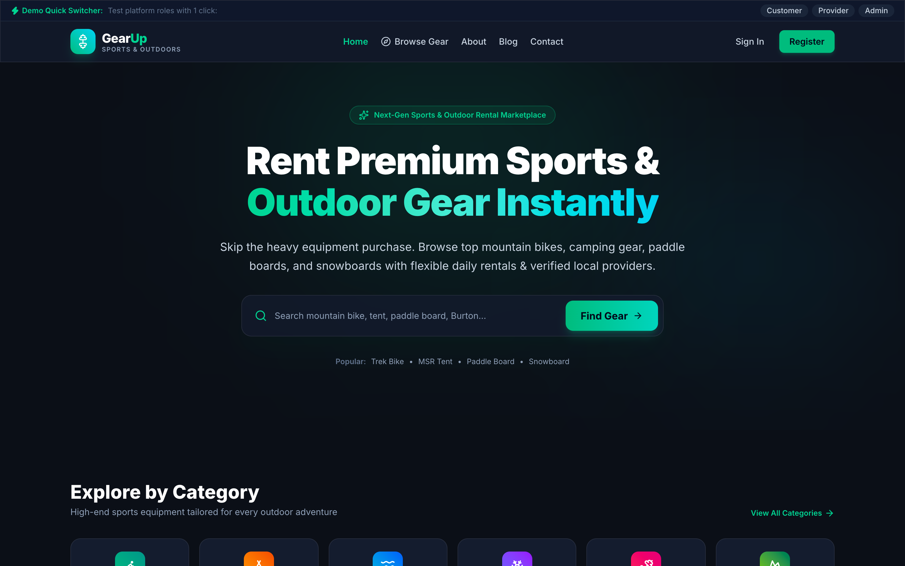
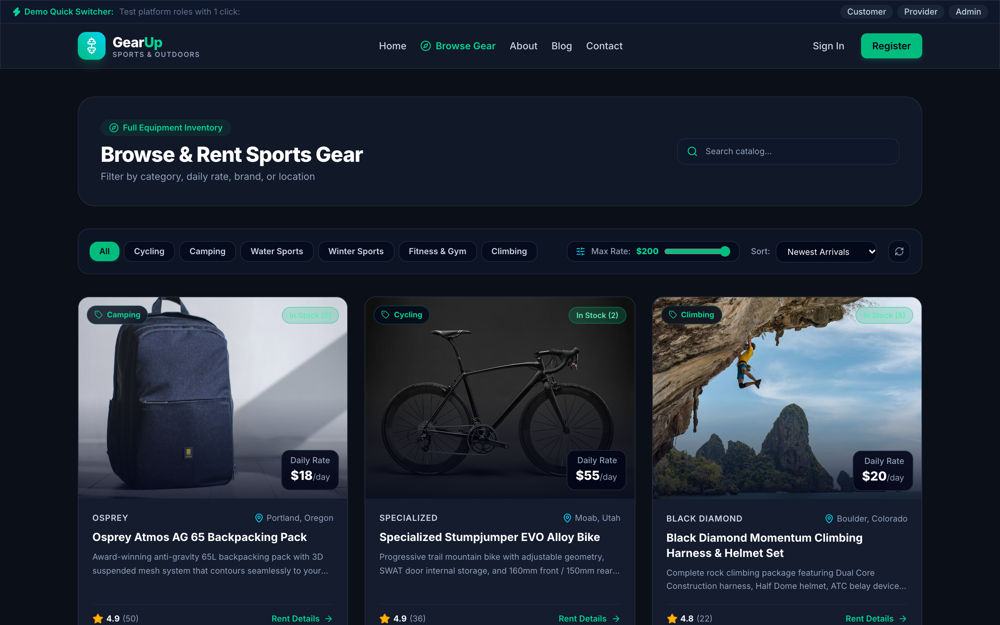
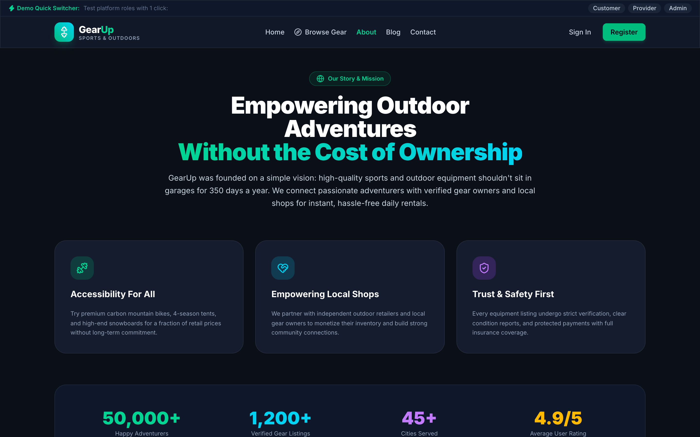

# GearUp

**Sports & Outdoor Equipment Rental Marketplace**


GearUp is a full-stack Next.js and Express/Prisma marketplace enabling outdoor enthusiasts to browse, filter, and rent high-end sports equipment—such as mountain bikes, camping gear, paddle boards, and snowboards—from verified local providers with role-based dashboards for customers, providers, and administrators.

---

## Screenshots

| Home Marketplace | Gear Catalog | About GearUp |
| :---: | :---: | :---: |
|  |  |  |

---

## Core Features

- **8-Section Marketplace Landing**: Hero banner, category grids, featured rentals, how-it-works walkthrough, platform metrics, testimonials, interactive FAQ accordion, and newsletter signup.
- **Catalog Exploration & Filtering**: Filter equipment by category and max daily rate slider, sort results, and paginate across available gear.
- **Role-Based Dashboards (Customer / Provider / Admin)**:
  - **Customer**: Browse catalog, book rentals, review spending analytics (Recharts area charts), view order history, and post verified star reviews.
  - **Provider**: Manage equipment inventory, list new gear, toggle availability, and process rental orders.
  - **Admin**: Moderate users (suspend/activate), manage categories, and inspect financial analytics (Recharts revenue bar charts & role distribution pie charts).
- **Reviews & Related Recommendations**: Star ratings, verified customer feedback, and related equipment suggestions on gear detail pages.
- **Theme System & Validation**: Light/dark mode with `localStorage` persistence and pre-hydration flash prevention, plus React Hook Form + Zod schema validation.

---

## Tech Stack

| Layer | Technology |
| :--- | :--- |
| **Frontend** | Next.js 16 (App Router), React 19, TypeScript, Tailwind CSS v4 |
| **State & Data** | TanStack Query, React Hook Form, Zod, Recharts, Lucide React, Sonner |
| **Backend API** | Node.js, Express 4.19, TypeScript, Helmet, Morgan, CORS, Cookie Parser |
| **ORM & Database** | Prisma ORM (`@prisma/client` v5.20), PostgreSQL |
| **Auth & Payments** | JWT (`jsonwebtoken`), bcryptjs, Stripe |
| **Deployment** | Vercel (`vercel.json`) |

---

## Project Structure

```text
GearUp-nextjs/
├── gearup/                      # Next.js 16 Frontend Application
│   ├── src/
│   │   ├── app/                 # App Router pages & layouts
│   │   ├── components/          # Reusable UI & dashboard components
│   │   ├── lib/                 # API utilities, auth & theme helpers
│   │   └── middleware.ts        # Route protection middleware
│   ├── server/                  # Embedded backend copy for monorepo dev
│   │   ├── api/
│   │   ├── prisma/              # Prisma schema & seed scripts
│   │   └── src/
│   ├── next.config.ts
│   └── package.json
├── gearup-backend/              # Standalone Express + Prisma Backend
├── requirements/                # Specification documents
├── vercel.json
└── package.json                 # Monorepo scripts (dev:all)
```

---

## Demo Accounts

Test all three role-based dashboards with one-click login or manual credentials:

| Role | Email | Password | Capabilities |
| :--- | :--- | :--- | :--- |
| **Customer** | `customer@gearup.com` | `Password123!` | Book gear, inspect spending history, leave reviews |
| **Provider** | `provider@gearup.com` | `Password123!` | Add/edit inventory, toggle availability, manage orders |
| **Admin** | `admin@gearup.com` | `Password123!` | User moderation, category management, revenue analytics |

---

## Local Setup

### Prerequisites

- Node.js 20+
- PostgreSQL database

### 1. Clone & Configure Backend

```bash
git clone https://github.com/IFTI-KAR/GearUp-nextjs.git
cd GearUp-nextjs

# Install frontend dependencies (inside gearup/)
cd gearup && npm install

# Install server dependencies & generate Prisma client
cd server && npm install
npx prisma generate
```

Create a `.env` file in `gearup/server/` (or `gearup-backend/`) with your PostgreSQL `DATABASE_URL`, `JWT_SECRET`, and optional `STRIPE_SECRET_KEY`.

### 2. Migrate, Seed & Run Concurrently

```bash
# Run migrations & seed demo data
npx prisma migrate deploy
npm run seed

# From repo root (or gearup/), run frontend (:3000) & backend (:5001) together
cd ..
npm run dev:all
```

- **Frontend App**: `http://localhost:3000`
- **Backend API**: `http://localhost:5001/api`
